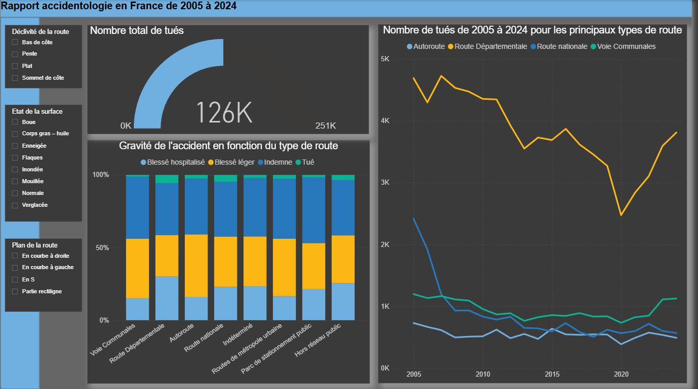
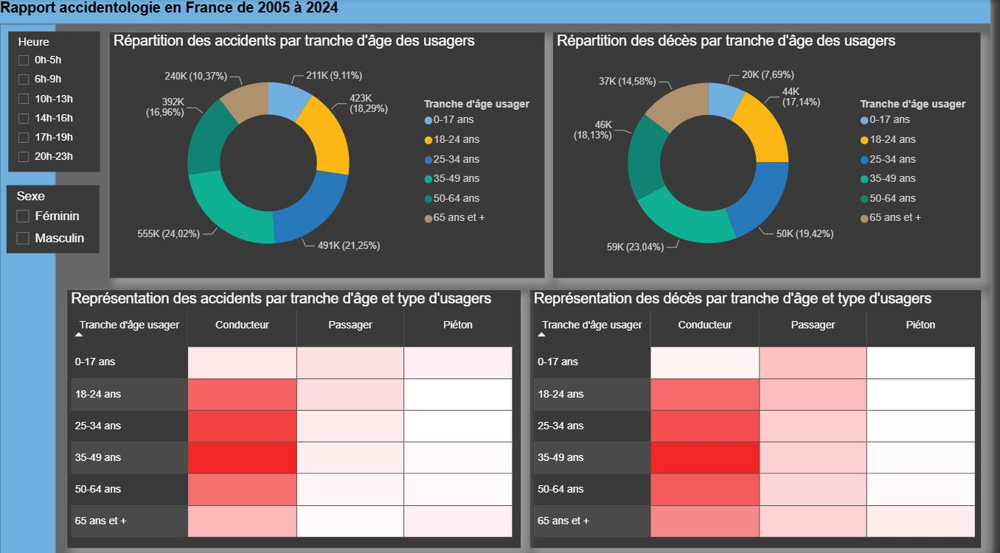
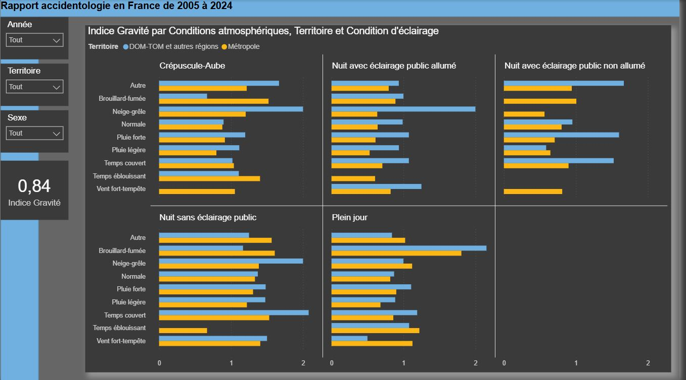
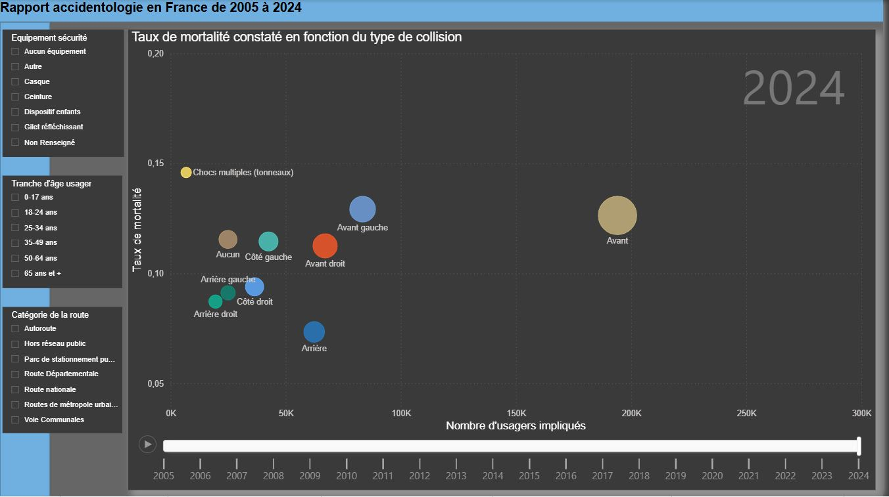

# Analyse des accidents corporels de la route en France (2005-2024)

#

## Présentation du projet

Ce projet vise à explorer et analyser les accidents corporels de la circulation en France entre 2005 et 2024, à partir des données publiques disponibles, afin d'identifier des tendances temporelles, géographiques et contextuelles.

Le projet s'inscrit dans une démarche d'analyse de données : préparation et exploration des données, structuration d'un modèle analytique, création d'indicateurs et visualisation des résultats.

## Outils utilisés

-Python : exploration, préparation et analyse des données.

-Pandas, Matplotlib, Seaborn : visualisations.

-Power BI : modélisation des données, création d'indicateurs et visualisations.

## Contenu du projet

-Rapport interactif Power BI.

-Rapport méthodologique et analytique.

-Présentation synthétique du projet.

## Périmètre

L'analyse porte sur les accidents corporels recensés en France sur la période 2005-2024. Elle s'appuie sur les données publiques relatives aux accidents, aux lieux, aux véhicules et aux usagers.

## Démarche

Le projet comprend plusieurs étapes :

-Collecte et préparation des données.

-Exploration et analyse des données avec Python.

-Structuration et modélisation des données dans Power BI.

-Création d'indicateurs et de visualisations.

-Analyse des résultats et restitution.

## Livrables

- [Rapport final](documentation/Accidents_routiers_rendu-final_AB.pdf)
- [Présentation de soutenance](documentation/Présentation_soutenance.pdf)

#
#

## Visualisations Power BI

## Contribution personnelle

- Prétraitement et nettoyage des tables **LIEUX** et **USAGERS** avec Python.
- Réalisation de visualisations exploratoires avec Matplotlib et Seaborn à partir des données prétraitées par l'ensemble du groupe.
- Rédaction intégrale du rapport final d'analyse.
- Conception de 4 pages du rapport Power BI (pages 2, 3, 6 et 7).
- Rédaction des slides associées aux pages réalisées et de l'introduction de la présentation de soutenance.

### Vue générale

### Analyse des usagers

### Analyse du contexte

### Analyse des collisions

